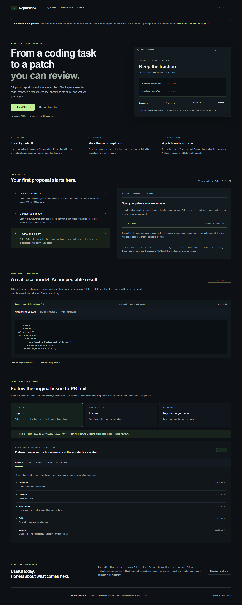
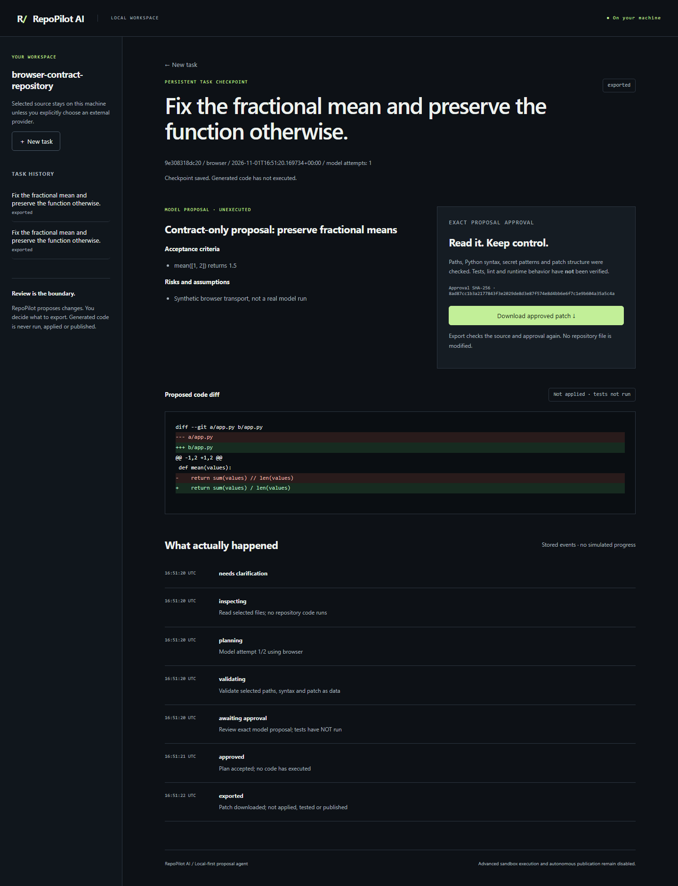

# PR #10 QA report

## Preview distribution follow-up — 2 November 2026

**Preview software: CONDITIONAL PASS for the documented experimental scope.** It can be
distributed independently of personal-PC inference, with the unverified full real-model
journey visible in onboarding/public UI/docs. Stable acceptance remains NOT MERGE READY.
No merge, new deployment, public Release or real-model acceptance is claimed by this report.
Final remote checks and download artifacts belong to the exact head shown on PR #10.

| Changed-scope check | Executed result |
| --- | --- |
| Ruff lint / format; mypy | Passed, 30 typed package modules |
| Full Windows backend regression | 304 passed, five existing environment skips, 93.77% coverage, 142.66 s; included first four packaging checks |
| Final packaging boundary tests | Five passed after adding the untracked-source rejection case |
| Frontend | 15 component tests, typecheck, private build and public production export passed |
| Browser integration | Eight passed: six public viewports, two synthetic local proposal/approval/real-download contracts |
| Final compatible-runtime command | Six public viewport checks passed after correcting the venv executable; no private-flow rerun needed |
| Security boundaries | No inference, generated-code execution, sandbox or autonomous publication enabled |
| Fresh Windows source install | Fresh official-branch clone, new venv, constrained install and pip check passed; installed launcher/assets/auth/missing-runtime errors and listener cleanup passed, no inference |
| Installer cleanup regression | Three tests passed: exited launcher, taskkill race with confirmed exit, and live cleanup failure without broader termination |
| Exact final CI | Consult the final PR checks and installed-package evidence; remote results are not preclaimed here |

A local fresh-install probe exposed a taskkill exit race after the test-owned launcher exited.
Cleanup now accepts a nonzero taskkill result only when bounded wait confirms launcher exit;
the existing listener-closed check still must pass. Failed live cleanup never broadens targets.
The corrected probe passed outside the checkout. The original failure evidence is retained.
The latest main-only baseline clarification is integrated without modifying main itself.
Artifact inspection caught PR builds using GitHub's temporary merge SHA; CI now pins the
actual branch head and checks provenance before producing named downloads. The final run
is the canonical check of that correction, not the earlier green run.

The public viewport checks cover 360/390/768/1366/1440/1920 px, reduced motion, setup controls,
preview labeling, no localhost/API requests, no horizontal overflow and no browser exceptions.
Native screenshots were inspected; existing dark/system-font composition and mobile ordering
remain intact. Earlier real-model recordings and synthetic browser transports remain separate.
The full genuine-model acceptance is still unverified; the RAM guards remain 1,536/512 MiB.
No application/service was closed to create headroom. No WSL, Hyper-V or administrator operation
was used. Below is retained historical evidence from the preceding checkpoint.

## Prior checkpoint verification

**Release verdict: NOT MERGE READY — real-model acceptance remains blocked by RAM.**
Independent local gates pass. Current remote CI results are the checks attached to
[PR #10](https://github.com/naraya07pedro-spec/repopilot-ai/pull/10); this report does not
preclaim a result for a future pushed commit.

| Check | Executed result |
| --- | --- |
| Ruff check / formatting | Passed |
| Strict mypy, win32 and linux platforms | Passed, 30 application modules |
| Backend `pytest --cov` | 300 passed, five environment skips, 93.81% coverage, 136.08 s |
| Skips | Four PostgreSQL cases not configured locally; one Windows symlink privilege case |
| TypeScript / component tests | Passed; 15 component tests |
| Public production build | Passed, Pages base path `/repopilot-ai` |
| Public setup browser checks | Six viewports: 360, 390, 768, 1366, 1440, 1920 px; reduced motion; no overflow/page errors/API or localhost requests |
| Local workspace browser checks | Two viewport journeys: clarification, runtime check, proposal, approval, actual patch download; explicitly synthetic model transport |
| Live public HTTPS | HTTP 200; desktop/mobile existing recording flows passed; private/API routes absent |
| Fresh Windows wheel install | New venv, PyPI runtime dependencies, no editable/source import, pip check passed |
| Installed console / assets / auth | Passed with cp1252 console; UI assets present; unauthenticated API rejected; missing runtime error verified |
| Installer cleanup | Own process tree stopped, test listener confirmed gone; no broader cleanup |
| Wheel integrity | 34 package files match source bytes; old experimental files rejected; clean wheel SHA in evidence |
| Fresh Linux install | New Ubuntu CI installed-package job verifies the same distribution/HTTP journey; consult current PR checks |
| Genuine model-through-app acceptance | NOT RUN: 896.43–1,003.54 MiB available vs 1,536 MiB start requirement |

The new browser suite supplements the existing browser suite; it does not replace sandbox
probes or real inference. Parsing Python is not execution. No model-generated Python ran,
no code was applied and no autonomous GitHub publication was enabled. No security bypass,
Windows restart, WSL/Hyper-V operation or change to OpenClaw was made.

The retained local logs, failed/rejected wheel, new source archive, clean wheel, fresh venv,
private launcher logs and sanitized installation receipts are under
`D:\Projects\repopilot-local\release-pr10-2026-11-01`. Launcher/session logs are deliberately
not committed or uploaded. [Sanitized evidence](evidence/pr10-release-readiness.json) records
hashes and the actual memory admission decision.

Remaining owner action: make sufficient free RAM available while keeping OpenClaw/Codex
running, then repeat only the guarded real-model acceptance. Keep the 512 MiB running floor,
CPU-only runtime settings and exact-proposal review. Do not merge based only on these tests.
