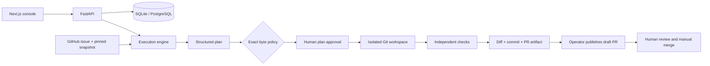

# RepoPilot AI

**A scoped issue → an isolated change → actual tests → a reviewable pull request.**

RepoPilot records the baseline, structured plan, approval digest, Git diff, command outputs,
exit codes, and a PR artifact. A failed check stays failed. Nothing auto-merges.

**Execution boundary:** this MVP runs only three explicitly trusted Python fixtures.
The default provider deterministically selects reviewed edits. An optional OpenAI-compatible
planner is implemented and contract-tested; live model quality is not claimed.
Arbitrary repositories and arbitrary model-generated code cannot execute on the host.

## Verified demonstration

[Issue #1](https://github.com/naraya07pedro-spec/repopilot-ai/issues/1) became
[draft PR #2](https://github.com/naraya07pedro-spec/repopilot-ai/pull/2) through the actual engine:
two failing assertions became three passing tests, followed by independent lint/format checks.
The published diff changes one line. The exact plan, outputs, commits and artifact are
[inspectable](docs/evidence.md). Publication used the connected GitHub integration;
no live paid-model or token-publisher result is implied.

[Verified CI](https://github.com/naraya07pedro-spec/repopilot-ai/actions/runs/40492779772):
72 backend tests, 95.68% statement coverage, 4 frontend tests, production build and Docker smoke.
See the review branch's latest checks for subsequent documentation and dependency hardening.
Browser visual QA remains blocked by the authoring environment. No public deployment is claimed.

## Review in 30 seconds

1. Start the console and select **Bug fix**.
2. **Start live local run**. Inspect the failing baseline and bounded plan.
3. **Approve fixture plan**. Inspect the diff and passing candidate checks.
4. Download the PR artifact. Publishing and merging remain separate actions.

The console also includes a scoped feature and an intentionally rejected regression.
Recorded data is labeled **replay**, never presented as a current run.

[Architecture](docs/architecture.md) · [Security](docs/security.md) ·
[Evidence](docs/evidence.md) · [Recruiter walkthrough](docs/recruiter-walkthrough.md)

## Why this problem matters

A plausible patch and a confident explanation do not prove correctness. Repository
automation must preserve a baseline, control changes, execute independent checks, and stop
at an explicit review boundary. This project adds Git modification and verification evidence
to the owner's existing runtime and integration portfolio. No customer deployment, production
scale, business impact, or additional professional experience is implied.

## Architecture



## Local setup — no paid services

Requires Python 3.12+, Git, Node.js 22.12+ and npm. Run one backend process.

```sh
python -m venv .venv
# macOS/Linux:
. .venv/bin/activate
# PowerShell instead: .venv\Scripts\Activate.ps1
python -m pip install -c requirements.lock -e ".[dev]"
python -m uvicorn repopilot.api:create_app --factory --host 127.0.0.1 --port 8000
```

In another terminal:

```sh
cd frontend
npm ci
npm run dev
```

Open [the local console](http://localhost:3000). Runs are saved under `.repopilot/`.
No token is needed for the fixed fixture demo. Operator routes are disabled unless
`REPOPILOT_API_KEY` is configured. Never expose the writable demo publicly.

Optional: `docker compose up --build` uses PostgreSQL and binds both ports to loopback.
Docker is defense in depth, not a complete hostile-code sandbox.
See [limitations](docs/limitations.md) for what has actually been verified.

## Demonstrations

```sh
python -m repopilot.cli demo --scenario bug --output evidence/bug.json
python -m repopilot.cli demo --scenario feature --output evidence/feature.json
python -m repopilot.cli demo --scenario failure --output evidence/failure.json
```

The failure scenario **must exit 1** with `verification_failed` and no PR artifact.
CLI demo invocation explicitly authorizes only catalog edits.

[Live GitHub procedure](docs/demo.md) fetches an actual issue and a commit-pinned fixture
snapshot. Publishing requires an approved artifact digest, an unchanged remote baseline,
and the approved repository. No generic clone-and-run endpoint exists.

## Verify

```sh
python -m ruff check .
python -m ruff format --check .
python -m mypy
python -m pytest --cov --cov-report=term-missing
python -m pip_audit -r requirements.lock
cd frontend
npm run typecheck
npm test
npm run build
npm audit
```

CI needs no external AI key or GitHub write token.
[Testing scope](docs/testing.md) and [actual evidence](docs/evidence.md) distinguish
configured checks from executed results.

## Repository structure

| Path | Responsibility |
| --- | --- |
| `repopilot/engine.py` | Plan, approval, edits, verification, PR artifact |
| `repopilot/policy.py` | Paths, repository, secrets, exact edit policy |
| `repopilot/runner.py` | Fixed commands, clean environment, time/output limits |
| `repopilot/github.py` | Bounded reads and separate authorized publication |
| `repopilot/providers.py` | Deterministic and optional structured planners |
| `repopilot/store.py` | Durable state, idempotency, atomic claims |
| `frontend/` | Evidence console |
| `fixtures/` | Explicitly seeded demonstration repositories |
| `tests/` | Behavioral, API, security, concurrency, adapter tests |
| `evidence/` | Actual execution records and reports |

This is a single-process reference, not a hosted multi-tenant coding service.
No arbitrary shell, task dependency installation, automatic merge, or production-readiness
claim. Read [security](docs/security.md), [decisions](docs/decisions.md), and
[limitations](docs/limitations.md). MIT license and original repository history preserved.
