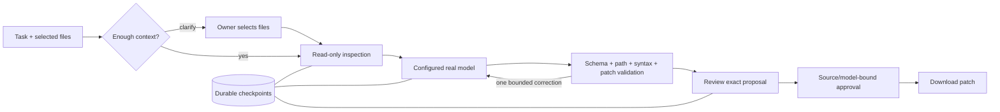

# RepoPilot AI

> **Baseline and preview:** `main` documents the reviewed fixture baseline. This branch is the self-hosted proposal preview in [draft PR #10](https://github.com/naraya07pedro-spec/repopilot-ai/pull/10), with Windows/Linux fresh-install CI coverage. Full genuine-model acceptance remains unverified. Model-generated code execution and autonomous publication remain disabled.

**Your coding task. Your model. A patch you can review.**

Release candidate: [PR #10](https://github.com/naraya07pedro-spec/repopilot-ai/pull/10).
Install from `codex/usable-agent-release` while review is pending. This is an **implementation
preview**: the complete installed-app → genuine model → approved patch acceptance remains
unverified. Tested software can be distributed as a labeled preview independently of the
evaluation PC's RAM. The deployed Pages site still hosts the earlier fixture release;
the new entry is a tested static artifact, not a claimed deployment.

RepoPilot is a local-first coding agent for focused Python changes. Select source files,
describe a task, invoke your model, review a structured proposal and export an approved patch.
It saves checkpoints, validates output, makes bounded correction attempts and waits for you.
**Generated code is never executed, applied or published by this edition.**

[Try RepoPilot](https://naraya07pedro-spec.github.io/repopilot-ai/) ·
[Install and run](docs/self-hosted.md) · [Capabilities](docs/capabilities.md) ·
[Recruiter walkthrough](docs/recruiter-walkthrough.md) · [Security](docs/security.md)

## Two ways to explore

**Public product entry preview:** inspect the new static artifact/setup instructions or open
the existing website's older fixture evidence. The candidate entry also labels an earlier real
CPU-model recording. The public site has
no live backend/model connection and never contacts your localhost or asks for credentials.

**Self-hosted workspace:** run the Python package against a repository and model runtime you
control. It includes its own local UI; no Node, WSL, VM, GitHub App or paid key is required.

## Quick start

Requires Python 3.12 (CI-tested), Git and an existing local model/runtime supporting structured
JSON output. Use the [Windows/Linux first-run commands](docs/self-hosted.md) to clone into a
new folder, install with `-c requirements.lock .`, and open the committed `examples/mean` starter.
For Linux:

```sh
git clone --branch codex/usable-agent-release --single-branch https://github.com/naraya07pedro-spec/repopilot-ai.git repopilot-preview &&
cd repopilot-preview &&
python3 -m venv .venv &&
.venv/bin/python -m pip install -c requirements.lock . &&
.venv/bin/repopilot local --repo examples/mean --model YOUR_INSTALLED_MODEL
```

On Windows use `.\.venv\Scripts\python.exe` and `.\.venv\Scripts\repopilot.exe`. For your own
committed repository use `--repo "D:\path\to\your-repository"`. The default provider is native Ollama
at `http://127.0.0.1:11434`. For a compatible llama.cpp server:

```sh
.venv/bin/repopilot local --repo examples/mean --provider compatible --endpoint http://127.0.0.1:8080/v1 --model YOUR_SERVED_MODEL_ALIAS
```

Open the private session link printed by the launcher on the same machine. RepoPilot never
installs a runtime or downloads a model automatically. [Windows/Linux virtual-environment
commands, model profiles and troubleshooting](docs/self-hosted.md).
For a pinned wheel, source archive, checksums and provenance, see the
[preview download guide](docs/preview-release.md). Actions downloads may require GitHub sign-in
and expire after 30 days; no PyPI/GitHub Release publication is claimed.

1. Select the Python files the task may read and edit.
2. Choose a model and optionally an explicit fallback. Check runtime availability.
3. Enter a task and acceptance criteria. Watch saved inspection/planning/validation stages.
4. Review the actual model diff, assumptions and risks; approve the exact proposal.
5. Download the patch. Source changes invalidate approval. The patch is not applied.

For a reproducible starter, point `--repo` at this clone's `examples/mean` directory and select
`app.py`. Ask: “Replace // with / in app.py. mean([1, 2]) must return 1.5. Preserve the empty-list
ValueError and all other lines. Return one complete app.py edit.” The included bug is intentional.

## An agent harness, with an explicit boundary



The loop permits at most two model invocations, uses only an explicitly selected fallback,
persists failures and usage, discards cancelled results, and never automatically replays an
uncertain request after restart. A single-process lease and one active request bound resource
use. No model tools can execute shell commands or repository code. [Implementation and
verification matrix](docs/capabilities.md).

The existing owner dispatcher, provider adapters, approval and publication contracts are
reused. This release adds a local repository source path to that infrastructure; it does not
merge the unverified sandbox runtime. Original history and experimental evidence are retained.

## Models and hardware

- **Local:** compatible llama.cpp and native Ollama endpoints on literal loopback addresses.
  CPU Qwen2.5-Coder 0.5B Q4_0 has produced a real guided one-file proposal on this 8 GiB Windows
  PC. It is a small experimental model, not frontier-level coding quality.
- **Your choice:** use a stronger model when your hardware supports it; configure context,
  output and timeout limits through profiles. Discovery alone does not validate model quality.
- **Optional external:** OpenAI, Anthropic and Gemini adapters are contract-tested. Live paid
  acceptance is not claimed. Credentials, configured budgets and explicit per-task consent
  are required; no paid service is mandatory or enabled by default.

See [measured local inference](evidence/qwen-local-inference-2026-11-01.json) and the current
release acceptance evidence. The 8 GiB Windows test profile needs sufficient free RAM; larger
models need more. Linux gets backend/HTTP/packaging CI coverage, with live Linux inference
through the workspace still unverified. [Requirements and exact scope](docs/self-hosted.md).

## What is deliberately gated

Model-generated code execution, isolated tests and autonomous GitHub publication remain
**disabled**. A reviewed sandbox must pass real filesystem, network, resource, cancellation,
cleanup and recovery probes before those advanced paths can activate. No host-execution
fallback, security bypass, paid infrastructure or public PC tunnel is used.

[PR #8](https://github.com/naraya07pedro-spec/repopilot-ai/pull/8) preserves failed experimental
sandbox evidence. `feat/hyperv-worker-evaluation` preserves separate preparation work. Neither
is merged wholesale into this release. The genuine local model → isolated tests → draft PR
acceptance has **not** succeeded. This proposal edition does not depend on that milestone.

## Evidence and provenance

The website distinguishes **real-model recordings** from **deterministic trusted fixtures**.
The older [Issue #1](https://github.com/naraya07pedro-spec/repopilot-ai/issues/1) →
[PR #2](https://github.com/naraya07pedro-spec/repopilot-ai/pull/2) demonstrates actual fixture
Git changes, tests and review artifacts; it is not evidence of autonomous AI sandbox execution.
Failed checks remain failed. [Historical evidence](docs/evidence.md).

The latest release report records executed tests, real inference, screenshots, installation
and deployment results. [Recruiter walkthrough](docs/recruiter-walkthrough.md) gives a short,
reproducible product tour and honest limitations.

## Development

```sh
python -m venv .venv
# Activate it, then:
python -m pip install -c requirements.lock -e ".[dev]"
python -m ruff check .
python -m ruff format --check .
python -m mypy
python -m pytest --cov
```

The public Next.js App Router site remains in `frontend/public-site`; the existing private
Next console remains separate. For frontend changes, use `npm ci`, `npm test`,
`npm run typecheck`, `npm run build`, `npm run build:public` and the Playwright tests in
`frontend`. On a Windows PC with limited C: space, set this process's TEMP/TMP to a dedicated
D: development directory. Never migrate unrelated application configurations.

[Architecture](docs/architecture.md) · [Provider contracts](docs/providers.md) ·
[Deployment and rollback](docs/deployment.md) · [MIT license](LICENSE)
