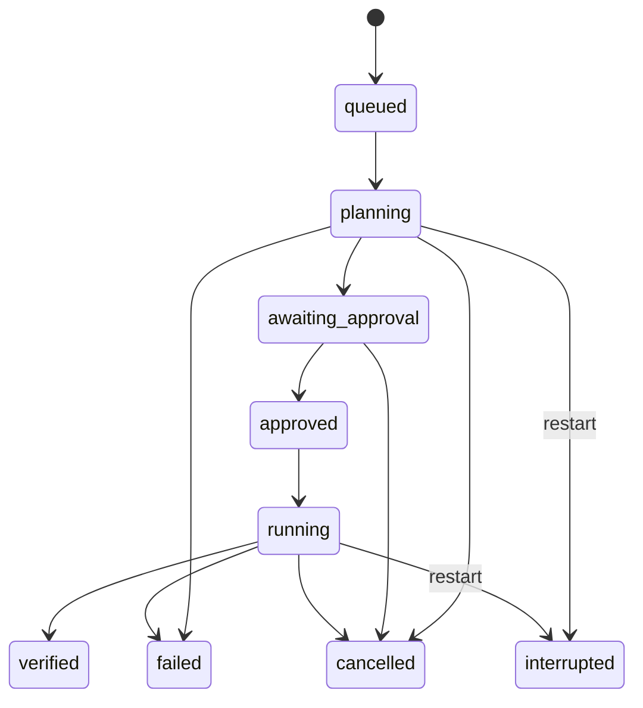

# Architecture

One FastAPI process owns two worker threads, a relational run store, and a Next.js console.
No broker, Redis, or multi-agent coordinator is needed.

Demo routes expose only catalog scenarios. Operator routes require a server-held bearer
key; private runs are excluded from demo reads. The Next.js proxy accepts only demo routes,
rejects cross-origin writes, and never forwards operator credentials to the browser.
Services bind to loopback by default.

## Execution

1. Reserve a unique idempotency key; reject a conflicting request fingerprint.
2. Atomically claim queued work.
3. Materialize reviewed bytes in a new workspace and Git repository.
4. Record the baseline commit; inspect tracked files within count and byte budgets.
5. Execute baseline tests in an independent subprocess.
6. Validate the structured plan and exact approved edits; expose assumptions and risks.
7. Bind approval to the plan, issue and baseline digest.
8. Recheck baseline and bytes, then apply authorized files.
9. Inspect the diff and execute checks with recorded outputs and exit codes.
10. Commit only a passing candidate and prepare its PR artifact.

## State

Conditional SQL updates prevent duplicate execution claims. Restart marks active work
interrupted; it never silently retries uncertain external writes. Cancellation is checked
between stages and polled while a subprocess runs.

## Inspection and storage

The inspector discovers tracked files, bounds context, and reports the supported Python/pytest
profile and dependencies. It does not claim general framework detection. Remote ingestion
reads the two selected fixture files at an immutable GitHub commit, verifies type/size,
and requires exact equality with the catalog.

SQLAlchemy schema v1 has one table. SQLite enables no-service setup; Compose supplies
PostgreSQL. Future schema changes require migrations; create_all is used only for this
initial additive schema. Run IDs correlate events, workspaces, branches and logs.
Runtime is measured. Cost and token usage are not invented.
