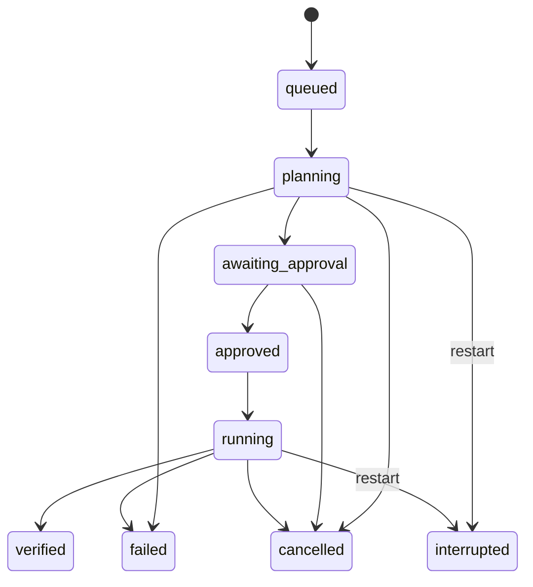

# Architecture

One FastAPI process owns two worker threads, a relational run store, and a Next.js console.
No broker, Redis, or multi-agent coordinator is needed.

Demo routes expose only catalog scenarios. Operator routes require a server-held bearer
key; private runs are excluded from demo reads. The Next.js proxy accepts only demo routes,
rejects cross-origin writes, and never forwards operator credentials to the browser.
Services bind to loopback by default.

## Execution

1. Reserve a unique idempotency key; reject a conflicting request fingerprint.
2. Atomically claim queued work.
3. Materialize reviewed bytes in a new workspace and Git repository.
4. Record the baseline commit; inspect tracked files within count and byte budgets.
5. Execute baseline tests in an independent subprocess.
6. Validate the structured plan and exact approved edits; expose assumptions and risks.
7. Bind approval to the plan, issue and baseline digest.
8. Recheck baseline and bytes, then apply authorized files.
9. Inspect the diff and execute checks with recorded outputs and exit codes.
10. Commit only a passing candidate and prepare its PR artifact.

## State

Conditional SQL updates prevent duplicate execution claims. Restart marks active work
interrupted; it never silently retries uncertain external writes. Cancellation is checked
between stages and polled while a subprocess runs.

## Inspection and storage

The inspector discovers tracked files, bounds context, and reports the supported Python/pytest
profile and dependencies. It does not claim general framework detection. Remote ingestion
reads the two selected fixture files at an immutable GitHub commit, verifies type/size,
and requires exact equality with the catalog.

SQLAlchemy schema v1 introduced the fixture run table. Additive schema version 2 includes
owner sessions, private run state, model budget reservations and a version record. SQLite
enables no-service local setup; Compose supplies PostgreSQL. Production requires PostgreSQL,
verified TLS and an existing private schema. Schema translation qualifies every application
table; private migrations enable RLS and revoke public/browser-role access. The dedicated
table owner is the trusted backend principal. No browser connects directly to the database.
Run IDs correlate events, workspaces, branches and logs.
Runtime is measured. Cost and token usage are not invented.

## V2 boundaries

The public static export embeds only approved fixture records and has no API. The owner
Next.js proxy forwards sessions to FastAPI, which holds App/model credentials and durable
PostgreSQL-compatible state. Private planning never calls the fixture executor. Approval
binds a pinned snapshot and proposed edits; execution remains disabled. See
[private workspace](private-workspace.md) and [deployment](deployment.md).

## V3 providers and worker protocol

An owner-selected registry supplies five wire adapters through the validated plan/edit contract.
Approval binds the snapshot, provider/model configuration, spending limit and expiry. The separate
[worker contract](worker-contract.md) extends private durable states with authenticated jobs,
atomic claims, bounded receipts, cancellation acknowledgements and restart recovery. It is a
control-plane protocol. Authenticated loopback transport and reconciled publication are implemented;
no sandbox runtime is packaged, and production dispatch/publication remains closed.
The fixture threads described above cannot accept these arbitrary candidate files.
