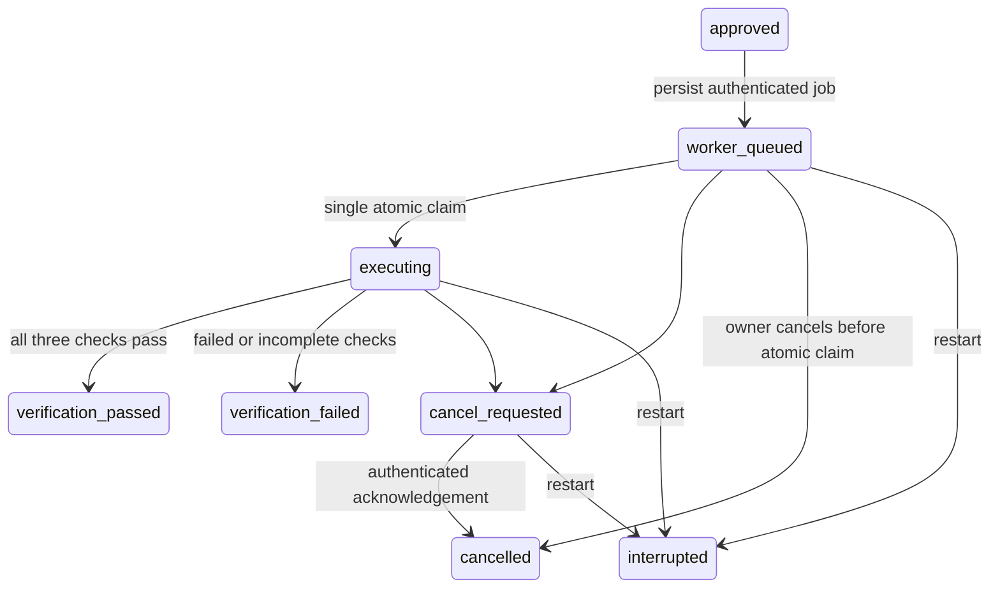

# Worker job and execution-receipt contract

Status: implemented and tested as a protocol/state machine, with a contract-tested loopback
transport. **No sandbox runtime is packaged or enabled**. The private execute route returns 409. Nothing in this
module launches a subprocess, provisions a machine, mounts a socket or writes candidate files.
A signed receipt authenticates a message; it does not independently prove isolation or execution.

## Control-plane lifecycle

The existing private run table stores the job, receipt and events. No queue or schema change
is required. The ledger accepts only an approved plan whose repository is still allowlisted,
configuration matches, digest matches the exact plan/snapshot/budget, and approval has not expired.
The owner inspects the derived unified diff before approval. The ledger combines the inspected
source with approved full-file edits in memory. Only bounded Python
source is eligible for this first verification profile; TypeScript planning remains inspection only.

Matching receipts transition the ledger to verification_passed or verification_failed.
This alone cannot publish a PR: publication also requires a separate digest, rechecked remote
baseline, matching candidate bytes and the closed runtime gate. Tests use synthetic receipts.

## Job and receipt boundaries

- HMAC-SHA256 uses distinct job/receipt domains, constant-time comparison and a minimum 32-byte
  controller key. The key is never included in a message, source file or stored run payload.
- A unique job nonce binds run ID, baseline commit, approval digest, source and resource policy.
  Repeated preparation returns the existing job. Repeated claims cannot run it twice.
- Jobs expire after at most five minutes and never outlive approval. Claims recheck configuration
  and repository allowlisting. Unknown fields, unsafe paths, case aliases, Windows device names,
  credential patterns, overlarge source and unsupported profiles are rejected.
- Resource requirements: non-root UID 65532, denied network, at most one CPU, 512 MiB memory,
  64 MiB writable disk, 32 processes and 60 seconds total checks. These are **declared requirements**,
  not currently enforced operating-system isolation. No host executor consumes these jobs.
- Fixed pytest/Ruff command arrays are selected by the protocol; no model-provided shell command,
  environment, package installation or filesystem mount is accepted. The runtime must separately
  suppress plugin/config discovery and supply trusted tools outside candidate-controlled paths.
- Receipts must match the exact job digest and nonce. Successful verification requires all three
  unique command outcomes, zero exit codes and no timeout/cancellation. Outputs and durations are
  bounded; secret-pattern outputs are rejected. Test counts are not inferred from prose.
- Receipt replay after a lost acknowledgement is idempotent. A conflicting/stale receipt is rejected.
  Cancellation remains requested until acknowledgement; requesting cancellation does not claim a
  process was stopped. Restart marks all active jobs interrupted, including jobs beyond the first
  history page. Recovery never automatically repeats uncertain execution or publication.

## Tests and remaining runtime work

The Windows-compatible owner dispatcher now connects authenticated execute/cancel routes to
the existing ledger and transport. Production constructs it without a worker, so execution
still returns 409 before creating a job, acquiring capacity or sending a request. There is no
environment setting that enables it. Publication retains its separate DisabledWorker gate.

With explicit synthetic test dependencies, scheduling persists the exact approved candidate,
shares bounded application capacity, submits concurrent duplicate requests once, and permits
queued cancellation to win against the atomic claim without sending code. Active cancellation
requires an authenticated acknowledgement; an unknown result is not replayed automatically.
Submission failure/restart marks unclaimed work interrupted and never replays it. Changes to
model timeout/configuration invalidate the selection binding just as model/budget changes do.

The owner HTTP workflow test covers plan -> exact approval -> text staging -> signed receipt ->
separate publication approval -> draft-PR reconciliation. Model/worker/GitHub replies in that
test are synthetic, and no staged source is imported or executed. Publication additionally
checks the accepted receipt digest, unchanged model binding and an independently read open
draft PR. These tests do not establish local inference or sandbox enforcement.

`python -m pytest tests/test_worker_contract.py -q` exercises signed-message tampering, forged
receipts, duplicate/concurrent claims, revoked repositories, expired approval/leases, changed
configuration, failed checks, receipt replay, cancellation races and restart recovery.
Receipts in these tests are explicitly synthetic protocol fixtures. Provider/browser contract
responses are also synthetic; their successful checks are not live model or sandbox evidence.

Before any production dispatcher is enabled, supply a separately reviewed disposable VM/microVM
worker with a secret-free guest and authenticated external controller. Independently demonstrate
network denial, filesystem containment, non-root identity, CPU/memory/disk/process enforcement,
process-tree cancellation, teardown on crash and adversarial escape/resource tests. The controller
must keep its authentication key outside tested code, validate receipt identity and reconcile
unknown outcomes. Docker Compose smoke checks of the application do not establish this boundary.

No suitable local runtime, Docker or installed WSL was available during this implementation.
No paid resources were created. The existing exact-byte fixture runner remains the only executable
repository path. General model-generated code stays disabled until this release gate is satisfied.
